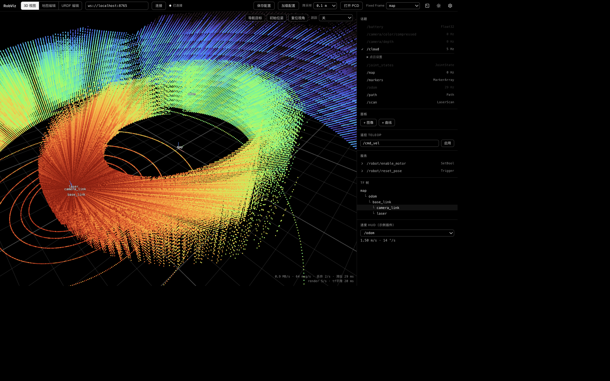
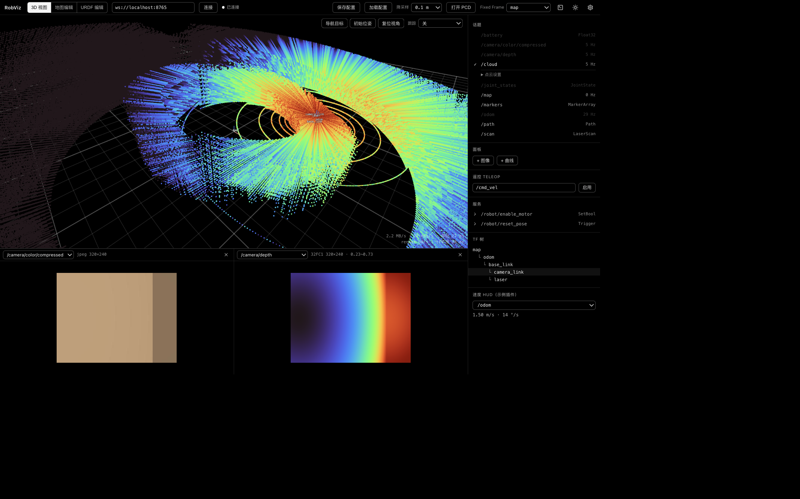
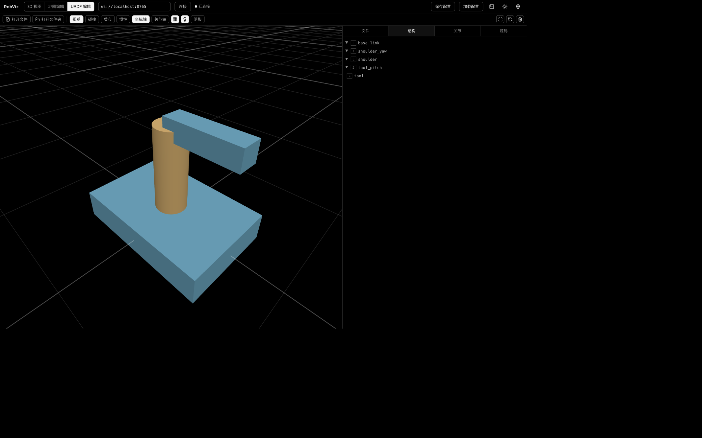

# RobViz

> A web-based robot dashboard that replaces rviz/rqt — connects straight to `foxglove_bridge` from the browser, zero deployment on the robot.

[](LICENSE)
[](tsconfig.json)

个人自用的 Web 机器人上位机，替代 rviz / rqt 的日常功能。浏览器直连 `foxglove_bridge`，机器人侧零部署。

**技术栈**：React 19 + three.js + TypeScript + Vite；连接与消息解码在 Web Worker 内完成，
主线程只做渲染；主应用无后端、无 Electron，`npm run build` 产物是纯静态页面。
远程终端按需启动操作电脑上的本地网关，不改变机器人侧部署。

**功能一览**：3D 显示（Map / LaserScan / PointCloud2 / Path / Marker / URDF / TF）、
图像面板（压缩图 + 深度图 turbo 上色 + 悬停取值）、曲线面板（多话题字段对比）、
遥控 Teleop、服务调用、Nav 目标 / 初始位姿、TF 树、视角跟踪目标、大 PCD 加载清理、
2D 地图编辑、布局配置保存/加载（rviz 式）、分割停靠工作区、多机器标签页、中英文与明暗主题、
远程终端、运行时插件开关、
CLI（agent 直接查询/操作机器人）。

**稳定性**：四层故障舱壁（面板错误边界 / 消息分发隔离 / 显示器隔离 / 连接 Worker 崩溃自愈），
任何单个功能崩溃不影响其余功能与数据流，已用故障注入实测（技术方案 §8.8）。

## 界面预览



<table>
  <tr>
    <td width="50%"></td>
    <td width="50%"></td>
  </tr>
  <tr>
    <td align="center">彩色相机与深度图并排查看</td>
    <td align="center">URDF 结构、关节、源码与物理辅助显示</td>
  </tr>
</table>

截图来自当前 Web 应用。

## 文档

- [执行方案](docs/01-execution-plan.md) — 范围、里程碑、验收标准
- [技术方案](docs/02-technical-design.md) — 架构、协议、模块设计、决策记录
- [UI 规范](docs/03-ui-design.md) — 单色系统设计令牌
- [插件指南](docs/04-plugin-guide.md) — 三类扩展点、PluginContext、示例与验证清单

## 快速开始

```bash
npm install
npm run dev
```

`npm run dev` 会同时启动 Vite 和本机终端网关，不需要再单独运行终端服务。

浏览器打开 dev server 地址，连接机器人上的 `foxglove_bridge`，例如
`ws://<robot-ip>:8765`。机器人侧启动方式见[连接真机](#连接真机)。

## 远程终端

终端网关运行在打开 RobViz 的操作电脑上，再通过系统 SSH 连接当前 Foxglove 地址中的
机器人 IP；机器人无需安装 RobViz 服务。开发模式下网关会随 `npm run dev` 自动启动。
如果使用 `npm run preview` 或直接部署静态构建产物，再单独启动本机网关并保持运行：

```bash
npm run terminal
```

在 RobViz 中按 Ctrl+反引号或点击顶栏终端图标，输入机器人 SSH 用户与密码；用户名和密码
保存在当前浏览器的本地存储中，SSH 密钥口令和 host key 确认仍直接在终端中完成。终端网关
固定监听 `127.0.0.1:8767`，只接受本机页面，浏览器与网关必须在同一台操作电脑。跨设备或
公网使用需要另行配置 WSS/反向代理，不应直接暴露该端口。

## 大地图工作流

- **加载 PCD**（重定位地图浏览）：顶栏"打开 PCD"，支持 ascii / binary / binary_compressed，
  可选加载时体素降采样（Mid-360 千万点建图产物建议 0.1m）。测试文件生成：
  `npx tsx scripts/gen-pcd.ts 20 /tmp/bigmap.pcd`（2000 万点）。
- **点云清理**（清除动态物体拖影）：加载后工具条切"框删/框留"，拖框即删/裁剪，
  可撤销，"导出"下载清理后的 binary PCD。
- **2D 地图编辑**：顶栏切"地图编辑"，打开 PGM+YAML（可多选）或"从 /map 抓取"；
  画笔/矩形绘制占用/自由/未知，导出 PGM+YAML 直接给 map_server 用。

## 日常面板

- **图像**：顶栏“添加面板 → 图像面板”，可同时创建多个并任意分割或合并为标签组；选择
  `Image` / `CompressedImage` 话题。深度图（32FC1/16UC1）自动
  turbo 上色并显示量程；悬停显示像素坐标与深度米数，视觉调参用。
- **曲线**：通过“添加面板 → 曲线面板”创建，选话题 + 字段点路径（如 `twist.twist.linear.x`），多序列共享
  接收时间轴与自适应量程，可独立显隐、删除或暂停。
- **遥控**：默认启用的 Teleop 插件；活动机器连接后显式启用，再用 WASD / 方向键 / 按住方向按钮以 10Hz 持续发布。切换机器标签或断线会清除输入并暂停，返回后需重新启用；话题和速度参数按机器标签保存。
- **服务**：宿主列出 bridge 广播的服务，按 schema 生成结构化参数表单并展示结构化响应。
- **Nav 工具**：默认启用的 Nav Goals 插件提供视口“导航目标 / 初始位姿”，点击定位置、拖动定朝向；默认发布到 `/goal_pose` / `/initialpose`，话题可在插件区块中按机器标签配置。
- **URDF**：顶栏进入"URDF 编辑"，可加载文件/文件夹、查看结构与物理辅助信息、控制关节、
  订阅 `/joint_states`，并在 XML 编辑器中修改、应用和下载 URDF。

### Panda URDF 示例

可用 Franka Emika Panda 的
[`panda_arm_hand.urdf`](https://github.com/corlab/cogimon-gazebo-models/blob/master/franka/robots/panda_arm_hand.urdf)
和配套 mesh 直接体验：

```bash
git clone --depth 1 --filter=blob:none --sparse \
  https://github.com/corlab/cogimon-gazebo-models.git
git -C cogimon-gazebo-models sparse-checkout set franka
```

进入“URDF 编辑”，选择“加载文件夹”，打开 `cogimon-gazebo-models/franka`。RobViz 会从
`robots/panda_arm_hand.urdf` 加载 Panda 机械臂，并按文件名解析 `meshes/` 中的 DAE/STL。

## Agent 接入（CLI）

agent（或人）直接跑命令即可查询/操作机器人，零 server 配置：

```bash
npm run cli -- topics                          # 列话题与服务
npm run cli -- echo /odom -n 3                 # 看消息（JSON，长数组截断）
npm run cli -- tf map base_link                # 查坐标链（含 yaw）
npm run cli -- pub /cmd_vel geometry_msgs/msg/Twist '{"linear":{"x":0.5}}'
npm run cli -- call /robot/reset_pose          # 调服务
npm run cli -- screenshot -o /tmp/shot.png     # 截 3D 视图（需浏览器打开页面）
```

`screenshot` 始终截取当前机器标签的 3D 面板；当前工作区已关闭 3D 时会明确报错。

真机加 `--bridge ws://robot:8765` 或设 `BRIDGE_URL`。`pub` / `call` 支持部分字段
JSON，缺省字段按 schema 自动补零。仓库内置 `.cursor/skills/robviz-cli`，
Cursor agent 会自动学会这些命令。

## 布局配置与设置

- 机器标签栏可新增、切换、双击或用 `F2` 重命名和关闭机器。用户自定义名称为主标签，连接 hostname 为次标签；名称、连接地址、激活话题、面板布局、相机、跟踪目标、3D 设置和插件状态均按机器标签保存。非活动机器保持连接，至少保留一个标签。
- 顶栏“保存配置”会把全部机器标签、各自 Dockview 布局以及全局语言、主题和插件设置保存到浏览器
  `localStorage`；“另存为文件”会下载 v2 `robviz.json`，“加载配置”从 JSON 文件恢复布局与插件状态。页面状态
  也会自动存 localStorage，旧 v1 单机配置会在启动时迁移，下次打开自动恢复。
- 右上角齿轮进入设置页，可切换中英文与明暗主题、控制主视图地面和 TF 轴宽、启停已打包插件、
  恢复默认工作区；所有设置立即生效。主题仍可用顶栏快捷按钮切换。
- 3D、图像、曲线、Topics、Echo、服务、TF 树和插件区块统一使用 Dockview：可上下左右
  分割、调整尺寸、交换位置、合并为标签组、最大化或关闭。3D 没有专属尺寸边界，关闭后其他面板
  可占满工作区；URDF 页面内部仍使用自己的分割器。
- 视口工具条"跟踪"下拉（或点 TF 树节点）：视角一键锁定目标 frame，
  跟踪中仍可自由旋转缩放。双击视口聚焦地面点，"复位视角"飞回默认机位。

旧开发版工作区中的独立 `teleop` 面板不会自动迁移；如导入后出现“未知面板类型”，请在 Dockview 中关闭该旧面板，或从设置恢复默认工作区。

## 插件

RobViz 默认打包并启用 Teleop 与 Nav Goals 两个控制插件；各机器的 Teleop 参数、导航话题会随会话配置保存。切换机器标签时，内置 Teleop 会暂停并清除输入，重新切回后需要显式启用。宿主不会为第三方插件制定通用的非活动会话写入策略。

想加自己的功能（自定义面板 / 3D 显示器 / 侧栏区块 / 视口工具）：

```bash
npm run plugin:new my-plugin   # 生成 src/plugins/my-plugin/index.tsx 骨架
```

每个插件放在 `src/plugins/<plugin-id>/index.tsx`，同级目录由 Vite 构建时自动发现；
右上角“设置 → 插件”可动态启停已打包插件，崩溃自动隔离不影响主体。完整契约见
[插件指南](docs/04-plugin-guide.md)；对 Cursor agent 说"帮我写一个 XX 插件"
即可（内置 `.cursor/skills/robviz-plugin` 会引导它）。

## 连接真机

机器人上安装并启动 bridge：

```bash
sudo apt install ros-$ROS_DISTRO-foxglove-bridge
ros2 launch foxglove_bridge foxglove_bridge_launch.xml
```

Web UI 连接 `ws://<robot-ip>:8765`。

### 机器人侧图像压缩

对于高分辨率 `sensor_msgs/msg/Image`，浏览器侧限帧只能减少解码和渲染负载，不能减少
Foxglove WebSocket 已经收到的 raw 字节。仓库内的 ROS 2 Humble 功能包
[`robviz_image_compressor`](ros2/robviz_image_compressor) 会先在机器人侧按 latest-wins 限帧，
再通过官方 `compressed_image_transport` 发布 JPEG；只有压缩 topic 有订阅者时才执行编码。

安装依赖，并把功能包放入任意 ROS 2 工作区的 `src` 目录：

```bash
sudo apt install ros-humble-image-transport ros-humble-compressed-image-transport
mkdir -p ~/robviz_ws/src
cp -r /path/to/robviz/ros2/robviz_image_compressor ~/robviz_ws/src/
cd ~/robviz_ws
source /opt/ros/humble/setup.bash
colcon build --packages-select robviz_image_compressor
source install/setup.bash
ros2 launch robviz_image_compressor compress_images.launch.py
```

默认配置在
[`ros2/robviz_image_compressor/config/images.yaml`](ros2/robviz_image_compressor/config/images.yaml)，
将 `/camera/camera/color/image_raw` 以 JPEG 质量 70、最高 10 FPS 发布为：

```text
/camera/camera/color/image_raw/compressed
```

消息类型为 `sensor_msgs/msg/CompressedImage`。配置多路图像时，在 `streams` 中增加唯一 ID，
再为每个 ID 配置 `input_topic`、`output_base_topic`、`max_fps` 和 `jpeg_quality`。使用其他配置文件：

```bash
ros2 launch robviz_image_compressor compress_images.launch.py \
  config:=/absolute/path/to/images.yaml
```

参数在节点启动时读取；修改 `max_fps` 或 `jpeg_quality` 后需要重启该压缩节点。

启动后可直接检查输出类型、帧率和带宽；这些命令会订阅压缩 topic 并触发按需编码：

```bash
ros2 topic info /camera/camera/color/image_raw/compressed
ros2 topic hz /camera/camera/color/image_raw/compressed
ros2 topic bw /camera/camera/color/image_raw/compressed
```

RobViz 图像面板发现 raw 与对应的 `/compressed` 后会优先选择压缩流，仍可手动切回 raw。
该功能包首版只用于彩色或普通灰度图像。`16UC1`、`32FC1` 等深度图不能使用普通 JPEG；
它们需要 `compressedDepth` 等保留深度数值的传输格式，目前不在此功能包范围内。

## 测试

```bash
npm test   # vitest：core 单元测试 + 终端网关集成测试
```

## License

[MIT](LICENSE) © Edmounds
